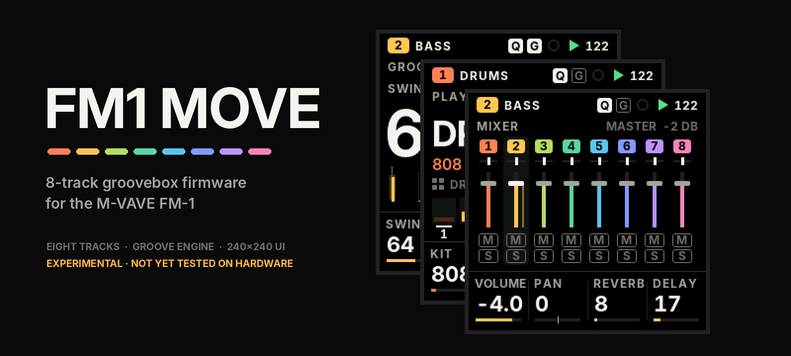
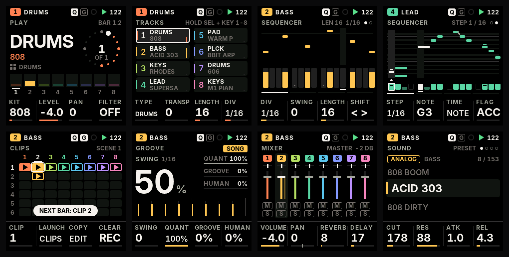

<p align="center"></p>

<p align="center">
<b>An eight-track groovebox firmware for the M-VAVE FM-1</b><br>
Groove Engine · eight tracks of any kind · a premium 240 × 240 interface designed for performance
</p>

<p align="center">
<a href="https://nicodesy06.github.io/FM1-MOVE/sim/"><b>▶ Try it in your browser</b></a> ·
<a href="#status">Status</a> ·
<a href="#features">Features</a> ·
<a href="#the-interface">Interface</a> ·
<a href="#controls">Controls</a> ·
<a href="#build">Build</a> ·
<a href="#documentation">Docs</a> ·
<a href="#credits-and-licence">Credits</a>
</p>

---

> [!WARNING]
> **Experimental, never run on hardware.** Everything below is implemented and verified in host simulation and with
> the real JieLi target compiler, but no FM1 Move build has run on a physical FM-1 yet. Do not install it on a device
> you are not prepared to recover (see [Recovery](#recovery)). The stable firmware this project builds on is
> [SLOOP](https://github.com/isod89/sloop-fm1).

## Status

| | |
| --- | --- |
| Firmware build (`FM1MOVE=1`) | ✅ compiles and links — 518 836 B of 581 564 B, RAM 92.6 / 96 KiB |
| Host tests | ✅ all FM1 Move suites pass (also under ASan + UBSan); SLOOP's 182 reference renders unchanged |
| Browser test view | ▶ [nicodesy06.github.io/FM1-MOVE/sim](https://nicodesy06.github.io/FM1-MOVE/sim/) — the firmware compiled to WebAssembly on a simulated panel (simulation, not the device) |
| Hardware | ⏳ not tested yet |
| Branch | [`fm1-move/dev`](../../tree/fm1-move/dev) — `master` is the untouched SLOOP 2.5 baseline |

## Features

### Eight tracks, no fixed roles
- **8 independent tracks**, each a **synth** or a **drum** track (any number of drum kits at once).
- Per track: pattern up to 64 steps with its own length and division (polymeter), level, pan, mute / solo, sends,
  filter, slicer, parameter locks, micro-timing, fill conditions, groove.
- 12 synth engines and 153 sounds from SLOOP; up to three tracks on the heavy engines (FM6, GRAIN, PHYS) at once.
- One shared 8-voice synth budget with predictable stealing that **never** exceeds it, even with eight held leads.

### Groove Engine
- **Non-destructive quantize** with strength 0–100 %: the recorded timing is kept, `q = raw + s · (grid − raw)`.
- **8 groove templates** (Straight, MPC 16, House, UK Garage, Broken, Rolling, Latin, User) with real timing offsets,
  velocity and accent maps — and a suggested swing, so swing is never applied twice.
- Swing per track and global, **micro-timing per step**, **offsets per drum pad** (early or late).
- **Deterministic humanize** (seeded: the same every loop and after a reload; REGEN draws new values).
- **Groove commit** with undo. Sample-clock timing: no drift, 0.73 ms event resolution.

### Projects
- Sparse, versioned **FM1M** format: a typical 8-track project is about 1 KB, eight full 64-step tracks about 5 KB.
- Power-loss safe: a save cut at any flash write leaves the old project or the new one, never a mix.
- Autosave; SLOOP's working project is imported on first boot.

### Kept from SLOOP
USB-MIDI in/out, TRS MIDI in, MIDI clock in, USB audio to a computer or phone, 16 punch-in effects, chord and
scale modes, arpeggiator, note repeat, USB updates and the USB rescue mode.

## The interface

Designed for the FM-1's 1.54" display at its native resolution: bold Inter numerals, a black background, eight
track colours, state shown by shape as well as colour, and only the screen rows that change are redrawn.

<p align="center"></p>

<sub>Every screen above is rendered by the firmware's own drawing code, running on a simulated FM-1 with the
8-track engine playing. More in <a href="docs/ui/live">docs/ui/live</a> and the design reference
<a href="docs/UI_DESIGN_SYSTEM.md">UI_DESIGN_SYSTEM.md</a>.</sub>

Ten screens: **PLAY · TRACKS · SEQUENCER · GROOVE · CLIPS · MIXER · SOUND · PERFORM · PROJECT · SETTINGS**.

## Controls

The two rows of buttons have one meaning each: the **top row is sound and mix**, the **bottom row is time and
arrangement**. Every screen is one press away.

| Button | Tap | Hold + keys / knobs |
| --- | --- | --- |
| **HOME** | PLAY | (held) PROJECT and SETTINGS |
| **SEL** | TRACKS | keys 1–8 select a track |
| **SEQ** | SEQUENCER | the 16 white keys are the steps |
| **ARP** | GROOVE | note repeat |
| **GLO** | MIXER | keys 1–8 mute, 9–16 solo |
| **FX** | PERFORM | punch-in effects |
| **EDIT / ENV / LFO** | SOUND (preset, envelope, LFO) | EDIT: erase, EDIT + OCT− / OCT+ undo / redo |
| **PLAY / REC** | transport / record | |

**SELECT** always picks the track, **PRESETS** the sound, **ALGORITHM** navigates the screen, and **KNOB 1–4** are
the four values along the bottom of the screen, in the same order as the knobs. Turning a knob shows its value large;
destructive actions ask first and confirm with the same button. Full map: [UI_MAPPING.md](docs/UI_MAPPING.md).

## Build

Linux x86-64 (or WSL), Python 3 with Pillow:

```sh
tools/get_deps.sh ~/fm1move-deps          # JieLi toolchain + the 3 SDK files it needs
export JIELI_TOOLCHAIN=~/fm1move-deps/jieli/toolchain AC79_SDK=~/fm1move-deps/ac79sdk
FM1MOVE=1 sh build.sh                     # -> build/felucca.fwsc (FM1 Move)
sh build.sh && sh tests/run_tests.sh      # the SLOOP-layout build, then every host test
python3 tools/ui_mockups.py               # render the screens (docs/ui/)
```

## Recovery

FM1 Move keeps SLOOP's update and rescue paths unchanged: hold **OCT−** while switching on for the USB rescue mode
(two failed boots enter it by themselves), then install another firmware — or the official one — from the
[FM-1 Firmware Hub](https://fm1.designburgapps.com) or SLOOP's web installer. Back up your SLOOP data with SLOOP's
web editor before trying FM1 Move. Installing custom firmware is at your own risk.

## Not there yet

Clips, scenes and capture · MIDI-out tracks and per-track MIDI channels · import of SLOOP's saved project slots ·
an 8-track web editor · dual-core research. See the [development plan](docs/DEVELOPMENT_PLAN.md) and the
[feature matrix](docs/FEATURE_MATRIX.md).

## Documentation

| | |
| --- | --- |
| [UI design system](docs/UI_DESIGN_SYSTEM.md) · [navigation](docs/UI_NAVIGATION.md) · [mapping](docs/UI_MAPPING.md) | the interface |
| [Groove Engine](docs/GROOVE_ENGINE.md) · [project format](docs/PROJECT_FORMAT.md) | the core modules |
| [Hardware audit](docs/HARDWARE_AUDIT.md) · [memory budget](docs/MEMORY_BUDGET.md) · [codebase map](docs/CODEBASE_MAP.md) | the platform |
| [Test report](docs/TEST_REPORT.md) · [changelog](docs/CHANGELOG.md) · [plan](docs/DEVELOPMENT_PLAN.md) | progress |

## Credits and licence

FM1 Move is based on **[SLOOP](https://github.com/isod89/sloop-fm1)** by isod89, itself based on
**[Felucca](https://github.com/hugelton/Felucca)** by Leo Kuroshita / Hügelton Instruments. SLOOP's original README is
kept as [SLOOP_README.md](SLOOP_README.md). Hardware research from [FM-1-RE](https://github.com/AL-255/FM-1-RE) and
[Dinghy](https://github.com/zvenson/dinghy).

Code: **GPL-3.0-only** ([LICENSE](LICENSE), [LICENSING.md](LICENSING.md)). Interface font: [Inter](https://github.com/rsms/inter),
SIL Open Font License 1.1 ([assets/fonts/inter/OFL.txt](assets/fonts/inter/OFL.txt)).

"M-VAVE" and "FM-1" are trademarks of their respective owners. FM1 Move is independent firmware, not affiliated with
or endorsed by them. It never enables the device's Bluetooth / Wi-Fi radio.
