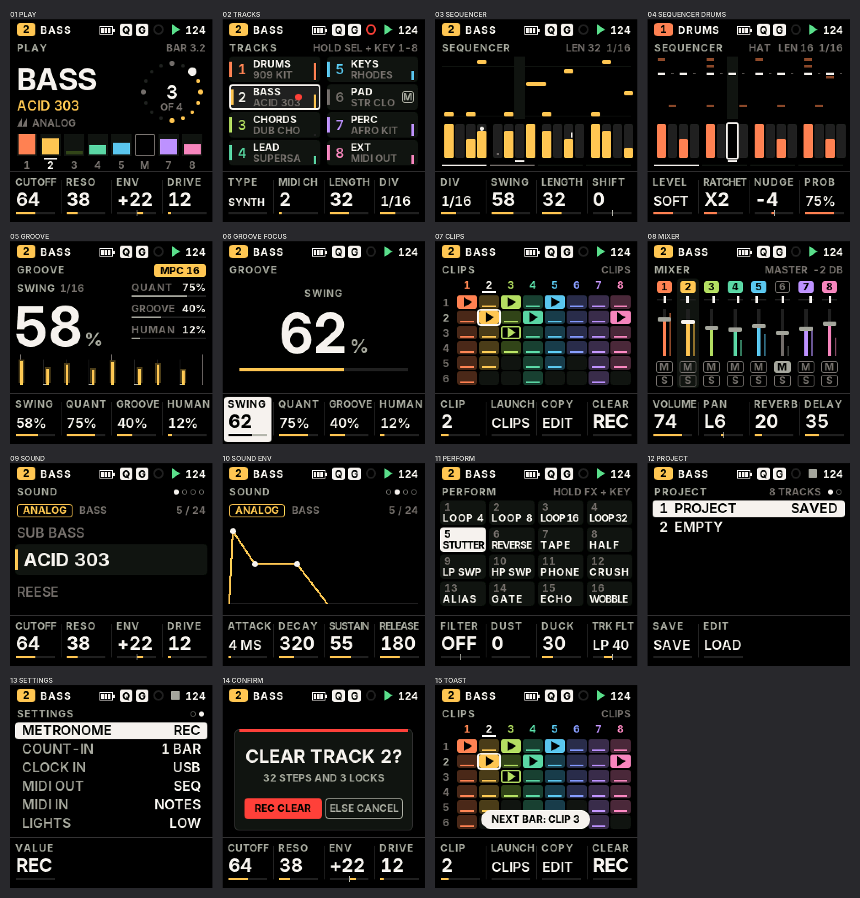
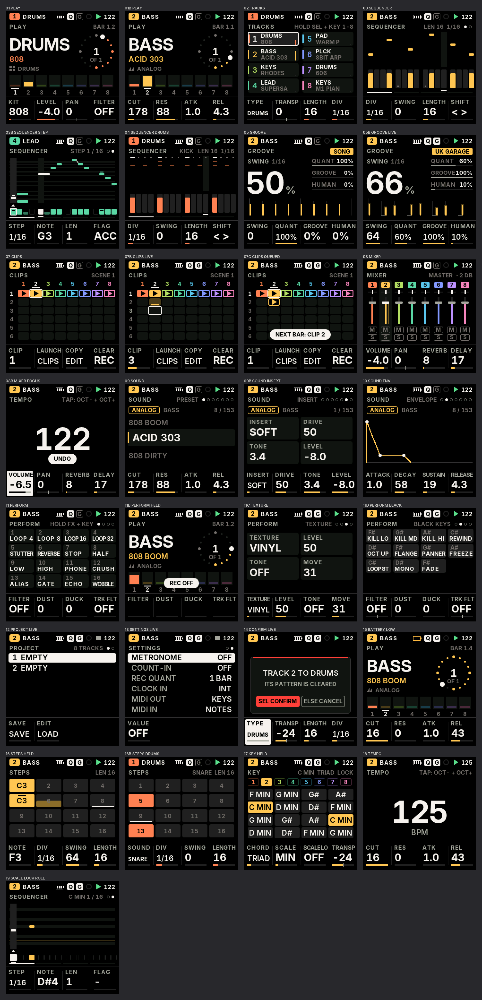

# FM1 Move — UI design system

The specification of the FM1 Move interface for the FM-1's 1.54" 240 × 240 IPS panel. The implementation is
`firmware/src/ds.c` (tokens, type, primitives, components, band renderer) and `firmware/src/ui_move.c` (screens).
Every image in `docs/ui/mockups/` is rendered **by that firmware code** on the host (§10), at native resolution.

Status: design system, ten screens, live adapter and controls are **in the FM1MOVE firmware** (it builds and links:
518 836 B image) and run on a host "virtual FM1" (`tests/fm1move_ui_test.c`). **Not yet seen on a real panel.**



Live screens — the FM1MOVE firmware's controller and engine on the virtual FM1, driven like a user
(`docs/ui/live/`):



## 1. Principles

1. **One glance.** Under a second, during a performance, the user knows: the screen, the track (number + colour +
   name), what the four knobs do, whether recording, quantise and groove are on, and what plays.
2. **Three levels, always.** Primary (one dominant element: a big value, a name, the pattern), secondary (the knob
   strip, lists), tertiary (status, hints, units). Never two primaries on one screen.
3. **Few, large, aligned.** Fewer items readable at arm's length beat more items that need squinting. Minimum text is
   12 px capitals (cap height 9 px ≈ 1.0 mm on this panel).
4. **State by shape, then colour.** Selected = white frame or inversion; on/off = filled/outlined; muted = hollow +
   "M"; recording = a disc (armed = a ring). Colour adds identity, never carries meaning alone.
5. **Same control, same place, same look.** KNOB 1–4 are always the bottom strip, in panel order; SELECT always picks
   the track; PRESETS always browses the sound; the touched value always takes the body.
6. **Every pixel earns its place.** No gradients, no shadows, no ornaments. Geometry: rectangles with small radii,
   discs, rings, 1–2 px rules.

Inspiration (principles only, no assets): the bold, flat readouts of Teenage Engineering, the strict knob/parameter
correspondence of Elektron, the immediacy and colour-coded tracks of Ableton Move.

## 2. Colour

### 2.1 Neutrals (warm black → white)

| Token | RGB | Use |
| --- | --- | --- |
| `DS_BG` | 0 0 0 | screen background (IPS black, lowest power, highest contrast) |
| `DS_SURF1` | 20 20 22 | cards, cells, selected strip |
| `DS_SURF2` | 34 34 37 | raised: empty steps, gauge tracks, selected card |
| `DS_LINE` | 48 48 52 | rules (knob strip separator, modal border) |
| `DS_TEXT3` | 112 111 106 | tertiary: hints, units, inactive numbers |
| `DS_TEXT2` | 166 165 158 | secondary: labels, screen name |
| `DS_TEXT1` | 244 243 238 | primary: values, names; **the selection fill** (inverted text on it) |

### 2.2 Track colours

Eight hues at equal steps, matched lightness, moderated chroma (vivid on black without glare). Track *n* keeps its
colour on every screen: chip, meters, steps, faders, clips, gauges.

| 1 | 2 | 3 | 4 | 5 | 6 | 7 | 8 |
| --- | --- | --- | --- | --- | --- | --- | --- |
| 255 128 82 tangerine | 250 196 84 amber | 182 220 98 lime | 92 214 166 mint | 92 196 236 sky | 132 152 255 periwinkle | 190 146 250 lavender | 246 132 186 rose |

Derived: `DS_DIM(c)` (31 % over black: inactive fills, clips that exist but do not play), `DS_MID(c)` (56 %:
secondary marks).

### 2.3 Semantic

| Token | RGB | Meaning (always with a shape) |
| --- | --- | --- |
| `DS_REC` | 255 64 56 | recording (disc), armed (ring), destructive actions (modal bar, confirm button) |
| `DS_PLAY` | 92 220 140 | transport running (triangle), loaded project (dot) |
| `DS_WARN` | 255 184 64 | count-in (chip with the beats left), overload |

### 2.4 Contrast (verified)

`tools/ui_contrast.py` computes WCAG ratios **after RGB565 quantisation** and fails below the role minimum:
primary ≥ 7:1 (measured 18.9:1), secondary ≥ 4.5:1 (8.4:1), tertiary ≥ 3:1 (4.1:1 on black, 3.7:1 on a card), every
track colour ≥ 4.5:1 as text and as a chip behind black numbers (lowest: track 6, 7.97:1). On-device gamma and
viewing angle remain a hardware check.

## 3. Typography

Inter (SIL OFL 1.1, `assets/fonts/inter/`, licence included), rasterised by `tools/gen_dsfont.py` into 4-bit
anti-aliased glyphs, run-length coded, **only the glyphs each role needs**, tabular figures (values never jitter).
Capitals only (lower case folds to capitals).

| Token | Face, size | Cap height | Role | Glyphs | Flash |
| --- | --- | --- | --- | --- | --- |
| `DS_F64` | Inter Display Bold 64 | 47 px | hero numerals (swing, BPM, the focus value) | digits . - + % : / | 4.7 KB |
| `DS_F36` | Inter Display Bold 36 | 26 px | focus value when it is a word ("OFF", "1/16T") | caps, digits, signs | 8.6 KB |
| `DS_F22` | Inter Bold 22 | 16 px | names, knob values | caps, digits, signs | 5.1 KB |
| `DS_F16` | Inter SemiBold 16 | 12 px | list items, long knob values | caps, digits, signs | 3.8 KB |
| `DS_F12` | Inter Bold 12 | 9 px | labels, status, titles | caps, digits, signs | 2.7 KB |

Total 27.4 KB of flash. Rules: labels (`ds_label`) are tracked +1 px when they fit, tightened to 0 / −1 px when not;
a label that still does not fit is a **test failure** (`ds_clipped`), so UI text is designed to fit. User data
(preset and project names) may be clipped at its box edge. Values use `ds_fit`: the largest of F22 → F16 → F12 that
fits the cell.

## 4. Layout

Grid: 240 × 240, side margin 8 px, **four 60 px columns** aligned with KNOB 1–4, spacing scale 2 · 4 · 8 · 12 ·
16 · 24 · 32, radii 2 (steps) · 3 (chips) · 4 (cells, cards) · 6 (modal).

| Zone | Rows | Content | Level |
| --- | --- | --- | --- |
| STATUS | 0–23 | track chip (colour + number) and name · Q · G · REC · transport · BPM | tertiary (the chip is primary identity) |
| TITLE | 28–40 (baseline 38) | screen name · context (pattern length, scene, hints, page dots) | tertiary |
| BODY | 44–175 | the screen's content; the focus overlay replaces it while a knob turns | primary |
| KNOBS | 180–239 | four cells: label, value, gauge | secondary |

## 5. Components (`ds.c`)

| Component | Function | Notes |
| --- | --- | --- |
| Chip / outline chip | `ds_chip`, `ds_chip_line` | filled = on/selected, outline = off/optional |
| Badge Q / G | `mv_badge` | quantise / groove: filled when active, outline when not — always visible |
| Track chip | status bar | 22 × 16, track colour, black number |
| Knob cell | `mv_knobs` | label 12 px, value 22 px (fit), gauge 46 × 3 in the track colour; the turned knob's cell is **inverted** |
| Focus overlay | `mv_focus` | label, the value in 64 px (36 px for words), unit, 200 px gauge; shown while a knob turns |
| Gauge | `ds_gauge` | unipolar, or bipolar from the centre with a centre mark |
| Step cell (STEP page) | `sc_seq` | note = filled, tie = half bar, rest = empty, accent = a cap, slide = a ramp to the next note; under a piano roll (black-key rows, C lines), cursor = raised column + white ▲, playhead tinted |
| Step | `sc_seq` | 11 × 40, fill height = level (ghost 30 %, soft 55 %, normal 80 %, hard 100 %), lock = dot, nudge = tick, held = white frame, playhead = white fill + underline, empty beat marks |
| Clip cell | `sc_clips` | empty (surface), holds a pattern (dim colour + bar), playing (filled + ▶ while the transport runs; current but empty = outline), queued for the next bar (outline + blinking ▶), cursor (white frame) |
| Channel strip | `sc_mixer` | number chip, pan marker, fader + cap, activity, M and S chips (filled = on) |
| Track card | `sc_tracks` | colour bar, number, name, sound, M/S/meter, armed dot, selected = white frame |
| List row | `mv_list` | selected row inverted; loaded item marked with a dot |
| Page dots | `mv_dots` | current filled, others rings |
| Modal (destructive) | `mv_modal` | red bar, question in 22 px, consequence in 12 px, **"REC CLEAR"** filled red, "ELSE CANCEL" outline |
| Toast | `mv_toast` | inverted pill above the knob strip, ~1.5 s |
| Icons | `ds_icon` | play, stop, rec, arm, synth (saw), drum (pads), MIDI (socket), lock, left/right, loop, note — drawn with primitives on a 12 px box, no bitmaps |

Primitives: rectangles, anti-aliased rounded rectangles and frames, discs, rings, arcs (`ds_arc`), supersampled
triangles, thick lines, blended text.

## 6. States

| State | Visual |
| --- | --- |
| selected | white frame (2 px) or inverted fill |
| active / on | filled shape |
| inactive / off | outline, or tertiary colour |
| muted | hollow, tertiary grey, the letter **M** replaces or joins the number |
| soloed | white chip with **S** |
| recording | red disc in the status bar; armed: red ring; track armed: red dot on its card |
| playing | green ▶ in the status bar, white playhead on steps, filled clip with ▶ |
| battery | three bars right of the track name, left of Q / G; empty: an empty cell in the warning colour (shape, not colour alone); BATTERY LOW toast once |
| count-in | amber chip with the beats left, in place of ▶ |
| queued | outlined clip with a blinking ▶ (starts on the next bar) |

## 7. Interaction patterns

- **Turn = see.** Turning a knob makes its value the primary element (focus overlay) and inverts its cell; the overlay
  closes ~1.2 s after the last detent. Exceptions: CLIPS and the SEQUENCER STEP page, where the edited thing (the grid,
  the step) stays visible and only the cell inverts. Values change by one detent = one step; fast turns accelerate (SLOOP's `accel`).
- **Hold + touch.** A function button held turns the keys into its layer (SLOOP's model): the screen shows the
  layer's mapping, the key LEDs show what is set.
- **Confirm destructive actions** by pressing the same button again (no encoder push on the FM-1); anything else
  cancels. The modal states the consequence ("32 STEPS AND 3 LOCKS").
- **Feedback in place.** Toasts for completed actions that leave the screen unchanged (duplicate, save).
- Navigation and control mapping: `UI_NAVIGATION.md`, `UI_MAPPING.md`.

## 8. Screens

| Screen | Primary | Secondary | Mockup |
| --- | --- | --- | --- |
| PLAY | the selected track's name and sound; the bar as a 16-step clock | the eight tracks' activity, macros | `01_play.png` |
| TRACKS | eight cards (1–4, 5–8) | kind, MIDI ch, length, division | `02_tracks.png` |
| SEQUENCER | the 16 steps of the page, one per white key | pattern overview (piano roll / 16 drum lanes), page bar | `03_sequencer.png`, `04_sequencer_drums.png` |
| SEQUENCER · STEP (synth, SEQ again) | the cursor's 16 steps as a piano roll over the pattern's note range, title "STEP n / LEN" | the steps as cells (note / tie / rest, accent, slide); STEP · NOTE · TIME · FLAG | live: `ui/live/03b-sequencer-step.png` |
| STEPS (SEQ held, any screen but SEQUENCER) | the page's 16 steps as a 4 × 4 grid of 53 × 28 tiles: note filled with its name (F16/F12), tie half filled, accent cap, lock dot, playhead bar, held step white frame | NOTE · DIV · SWING · LENGTH with values | live: `ui/live/16-steps-held.png`, `16b-steps-drums.png` |
| KEY (SEL held) | track chips 1–8, then the 16 white keys as tiles: chord (chord mode) or note; root filled, in scale raised, outside dim | CHORD · SCALE · KEYS · TRANSP with values | live: `ui/live/17-key-held.png` |
| GROOVE | the focused groove value at 64 px | the other three, the timing of two beats as it plays | `05_groove.png`, `06_groove_focus.png` |
| CLIPS | 8 tracks × 6 clips (all six rows visible); title "SCENE n" when every track plays clip n | CLIP cursor; LAUNCH / COPY / CLEAR on their buttons | `07_clips.png`; live: `ui/live/07b-clips-live.png`, `07c-clips-queued.png` |
| MIXER | eight strips | volume, pan, sends of the selected track | `08_mixer.png` |
| SOUND | the preset (browser with previous / next), or the envelope; LFO, SYNC, SENDS, INSERT, INSERT 2 (drums: INSERT, INSERT 2): the four values large (2 × 2, F22) | engine, category, macros | `09_sound.png`, `10_sound_env.png`; live: `ui/live/09b-sound-insert.png` |
| PERFORM | page 1 the 16 white-key effects as tiles numbered 1–16; page 2 the 11 black-key effects, tiles named F#, G#…; pages 3–4 TEXTURE / TEXTURE 2 values large; a held effect's tile inverted | master filter, dust, duck, track filter; TEXTURE values | `11_perform.png`; live: `ui/live/11d-perform-black.png`, `11c-texture.png` |
| TEMPO (ALGORITHM on PLAY / TRACKS / MIXER / PERFORM, OCT− + OCT+ tapped, button + SELECT) | the BPM in the 64 px numerals for ~1.5 s, "TEMPO" label; "TAP: OCT- + OCT+", or "FOLLOWS CLOCK IN" with dimmed numerals under an external clock | the screen's knob strip | live: `ui/live/18-tempo.png` |
| PROJECT | slot list | actions on their buttons | `12_project.png` |
| SETTINGS | setting list | value on KNOB 1 | `13_settings.png` |

Plus: confirmation (`14_confirm.png`) and toast (`15_toast.png`).

## 9. Rendering and performance

- **Band renderer** (`ds_render`): the frame is drawn in bands into the existing strip canvas (`cv_px`, 240 × 124:
  no new RAM); each row is hashed and **only changed rows are sent**, merged into runs (one window + one DMA each). A
  scene signature (hash of the view model) skips frames where nothing changed. RAM: 960 B of row hashes.
- Measured on the host (rows sent of 240): unchanged frame **0**; BPM change **9**; a playhead step on SEQUENCER
  **114**; a knob's next value **72**; opening the focus overlay 189. At 12 MHz SPI a row is 480 B ≈ 0.32 ms, so a
  playhead step costs ≈ 36 ms of SPI instead of 77 ms for a full frame. (Device timing: [TEST-HW].)
- Never in the audio ISR; no flash reads beyond XIP constants; bounded loops; integer math only.
- Next optimisations, if measurements ask: double-buffered bands (render band *n+1* while band *n* DMAs), column
  limits per run, a faster SPI clock if the panel tolerates it.

## 10. Tooling

```sh
python3 tools/ui_mockups.py          # builds tests/ui_mockups.c (ds.c + ui_move.c on the host), renders every screen
                                     # to docs/ui/mockups/*.png + contact_sheet.png, runs the redraw and label checks
python3 tools/ui_contrast.py         # contrast of every token pair after RGB565 quantisation
python3 tools/gen_dsfont.py OUT.h --preview fonts.png
```

## 11. Status and next steps

| Step | Status |
| --- | --- |
| Tokens, type, primitives, components, band renderer | done (host) |
| Ten screens + modal + toast from a view model | done (host, demo data) |
| Contrast and label-fit checks | done (automatic) |
| Live adapter (track/song state → view model) | done (`ui_move_ctl.c mv_fill`) |
| Replace SLOOP's drawing code on the device (`FM1MOVE=1`), measure flash | done: image 518 836 B (−49 KB vs SLOOP), canvas 240 × 60 (−30 KB pool) |
| Navigation on simulated controls | done: `tests/fm1move_ui_test.c` (checks incl. clips and the STEP page + 12 000-frame fuzz, ASan) |
| CLIPS grid (6 rows, cursor, queued), STEP page | done (host): live renders `03b-sequencer-step.png`, `07b-clips-live.png`, `07c-clips-queued.png` |
| Navigation on the real controls, frame time on the device | [TEST-HW] |
| Readability on the real panel | [TEST-HW] |
